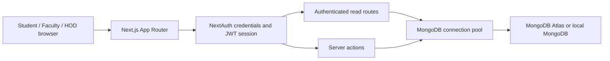

# Current architecture

This document describes the MongoDB-based CampusPulse application. Earlier Supabase notes are retained under [archive](archive/README.md) as historical material.

## Request flow

The landing page signs in through NextAuth's credentials provider. Account records live in `students`, `staff`, and `hods`. Session tokens contain the college identifier, role, and department. `PortalShell` keeps navigation consistent and `usePortalAccess` responds to account changes in the browser.

## Modules

| Area | Responsibility |
| --- | --- |
| `app/components/PortalShell.tsx` | Shared navigation, mobile menu, account controls |
| `app/components/Overview.tsx` | Role-specific overview, counts, recent records and notices |
| `app/api/dashboard/route.ts` | Fetches dashboard data together and scopes it to the session |
| `app/api/events/route.ts` | Loads event profile and proposal history in one response |
| `app/api/mongo/route.ts` | Authenticated compatibility reads for the remaining pages |
| `app/actions/` | Event, activity, user, notice and database-explorer mutations |
| `lib/authOptions.ts` | Credential verification and NextAuth session configuration |
| `lib/mongodb.ts` | Shared pending connection and MongoDB client pool |
| `lib/mongoAdapter.ts` | Compatibility query builder, filters, joins and writes |
| `lib/mongoAdapterClient.ts` | Browser reads forwarded to the server, with in-flight deduplication |
| `lib/client-session.ts` | Deduplicated, non-broadcasting session reads |
| `instrumentation.ts` | Begins an optional database warm-up at server startup |

Some module and variable names still say `supabase`. They are compatibility exports for the MongoDB adapters; this version does not require a Supabase project or SDK.

## Activity records

A student activity uses `group_activities.id` as its parent identifier. Each participant has an `activity_participants` record with `activity_id`, `student_uid`, and their individual approval status. `activity_mentors` links the same activity to faculty through `staff_suid`.

The participant workflow is:

`Pending → Pending Proof → Proof Submitted → Approved`

Faculty can also reject an activity. Proof and approval states belong to the individual participant; the group parent stores the shared activity information. Older records in `student_activities` remain readable in compatible history screens.

Faculty diaries use `staff_activities.activity_id`, with optional `staff_activity_comentors` and `staff_activity_participants` links. Related activity inserts are currently separate writes, not an all-or-nothing MongoDB transaction.

## Event records

`event_proposals` stores the organizer, department, schedule, venue, audience and budget. New proposals receive a server-selected owner and department and start with `pending` status. HODs can set `approved` or `rejected`. History readers normalize older capitalization and organizer fields.

## Notices

`broadcasts` stores department notices, audiences, expiry, pinning, attachment links and optional poll options. `broadcast_rsvps` stores responses. Visible activity views refresh on a 15-second interval and when returning to a tab; hidden tabs skip those polling reads. This is polling, not a MongoDB change-stream subscription.

## Performance

- The connection promise is shared across parallel requests and development reloads.
- Sign-in checks the three account collections concurrently.
- Dashboard and event bootstrap data are grouped into dedicated responses.
- Concurrent identical compatibility reads share a request.
- Sidebar routes prefetch on hover or keyboard focus.
- Portal pages include loading boundaries and avoid decorative entry animations.
- `npm run build` and `npm start` serve a compiled production build; `npm run dev` includes development overhead.

## Application boundaries

This repository is a college project and demonstration app. Its generic MongoDB compatibility read endpoint checks for a session and an allowed collection, but does not apply department restrictions to every query. The database explorer gives faculty/HOD users broad read/edit access. These boundaries require further authorization work before handling real institutional data.

Authentication still accepts older plaintext account passwords for compatibility; `npm run hash-passwords` migrates them to bcrypt. `/admin` remains an older placeholder screen and is not a fourth supported administration workflow. MongoDB-mode file storage is a stub: attachment URLs can be stored, but binary upload storage must be implemented separately.
