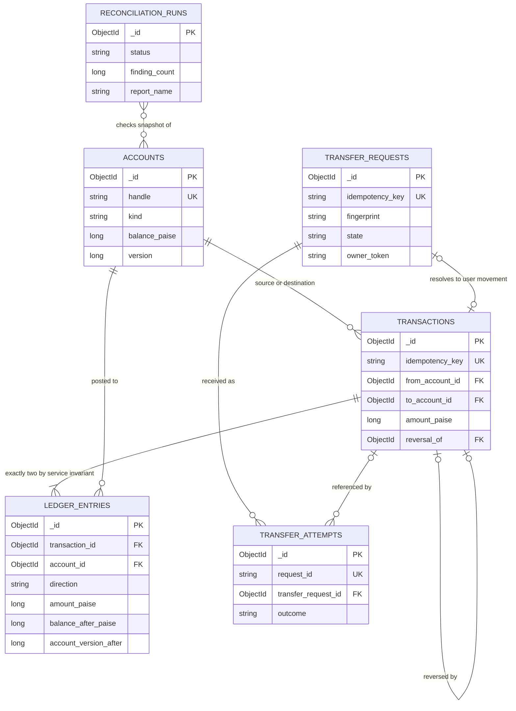

# LedgerLite — Product Requirements Document

**Version:** 1.0  
**Date:** 27 October 2026  
**Status:** Ready for implementation planning; assumptions in section 16 require team review.  
**Project:** College DBMS mini project, planned for 2–3 weeks.  
**Scope of this document:** Requirements and design only. No application implementation is included.

## 1. Overview and problem statement

LedgerLite is a simulated, UPI-style payment ledger that lets a student team demonstrate how a database protects money movements. A user creates demo accounts, transfers simulated INR, inspects the two ledger entries behind each transfer, retries requests, deliberately triggers failures, and runs reconciliation.

The central problem is that a payment cannot safely be implemented as unrelated balance updates. A crash between updates can lose money; concurrent balance checks can permit overspending; a repeated HTTP request can charge twice. LedgerLite must demonstrate measurable protection against all three problems and detect deliberately corrupted books.

Every committed money movement has one transaction document and exactly two immutable ledger entries: one debit and one credit of the same positive amount. Account balances are materialized projections of the ledger, maintained in the same MongoDB transaction for fast reads. Reconciliation independently recalculates those balances.

### Fixed architecture

| Layer | Required choice |
| --- | --- |
| Database | MongoDB, WiredTiger, replica set; an unsharded single-node replica set is sufficient for the local demonstration |
| Backend | Python 3.11+, Flask, synchronous PyMongo, REST JSON API |
| Frontend | Static HTML, CSS, vanilla JavaScript and `fetch`; files under `/static`, served by Flask |
| Data and tests | Faker for deterministic seed fixtures; pytest and a real replica set for integration tests |
| Deployment | One local Flask application and one MongoDB deployment; no queue, microservices, frontend build, or framework |

### Accounting convention

This project uses **wallet movement terminology**: `DEBIT` reduces an account's spendable balance, and `CREDIT` increases it. Therefore `balance = credits − debits`. This convention describes wallet movements; it is not a complete chart of financial accounts or a claim about debit/credit signs for every general-ledger account class.

Nonzero opening balances are also posted as balanced movements. A restricted system account, `opening-equity@system`, funds them. Its balance may be negative; ordinary user accounts may never be negative. This makes every account's balance, including the system account's, reconstructible from entries without an unexplained opening-balance adjustment.

## 2. Goals, non-goals, and success metrics

### Goals

1. Prove all-or-nothing financial writes using a visible mid-transfer failure.
2. Prove durable idempotency across repeated requests, concurrent requests, and application restarts.
3. Prove safe balances under conflicting concurrent transfers.
4. Demonstrate schema validation, unique and compound indexes, references, aggregation, snapshot consistency, and reconciliation.
5. Provide an understandable dashboard suitable for a laptop and classroom projector.
6. Deliver a runnable project, reproducible tests, and evidence suitable for an examiner.

### Non-goals

Real bank or UPI integration; real money; authentication, KYC or payment authorization; mobile applications; multiple currencies; external deposits or withdrawals after account creation; fees; partial refunds; microservices; frontend frameworks; a frontend build step; production high availability; fraud detection; a general accounting package; automated repair of corrupted books.

Database service credentials and collection permissions are infrastructure controls, not end-user authentication. The application is a local educational tool and must not be exposed as a real payment service.

### Release success metrics

| ID | Metric | Passing evidence |
| --- | --- | --- |
| SM-01 | Atomicity | At each supported failure point, transaction count, ledger count, both balances and both account versions are unchanged after abort |
| SM-02 | Idempotency | 100 simultaneous identical requests produce exactly one committed transaction and two entries; every resolved response identifies the same transaction |
| SM-03 | Concurrency | 500 transfer requests at concurrency 50 produce zero negative user balances and zero reconciliation findings |
| SM-04 | Reconciliation | Clean fixtures pass every invariant; each isolated corruption fixture produces the expected finding code and affected IDs |
| SM-05 | Query performance | With 100,000 committed user transfers, 200,000 corresponding entries plus opening entries, and 1,000 accounts, indexed recent-list queries meet p95 ≤300 ms under the section 10 benchmark |
| SM-06 | Demonstration | A fresh local setup completes the section 15 demonstration in ≤10 minutes, excluding installation and the large seed |
| SM-07 | UI | Required panels work at 1366×768 and 390×844; polling updates visible results within 10 seconds |

Financial correctness gates release even if a performance target is missed. Report a missed target with measurements rather than weakening an invariant.

## 3. Personas and user stories

| Persona | Need | User stories |
| --- | --- | --- |
| Student demonstrator | Explain a reliable payment workflow and reproduce failures | As a demonstrator, I can create two accounts, submit a transfer, and show its debit, credit and resulting balances. I can reuse a key and prove there was no second movement. |
| Student developer/tester | Reproducible fixtures and diagnostic evidence | As a developer, I can run isolated tests against a replica set, seed deterministic data, inject a known failure, and inspect the resulting reconciliation report. |
| DBMS examiner | Probe guarantees and their limits | As an examiner, I can inspect indexes and validators, challenge concurrent spending, and ask why a retry does not charge again. I can distinguish a committed payment from an unsuccessful request. |

## 4. Functional requirements

All requirements below are P0 unless explicitly marked P1. P0 constitutes the submission scope.

| ID | Requirement | Measurable acceptance criteria |
| --- | --- | --- |
| FR-01 | Create and list accounts | `POST /api/accounts` creates one user account with a normalized unique handle, display name, opening balance and status. `GET /api/accounts` returns current balances with pagination. Creating the same handle twice returns 409 and creates no additional funding movement. |
| FR-02 | Record opening funds correctly | A positive opening balance creates the account, one `OPENING` transaction, two entries and the system-account update in one ACID transaction. A zero opening creates no financial transaction or entries. Reconciliation passes in both cases. |
| FR-03 | Execute an atomic transfer | A successful request creates exactly one transaction and two entries and updates both balances and versions within one MongoDB session transaction. A failure after any intermediate write leaves zero new financial documents and no changed balances or versions. |
| FR-04 | Enforce durable idempotency | Every valid transfer or reversal carries a key. Same key and normalized payload returns the saved terminal status and business response, including the same transaction ID or original error. A different payload with that key returns 409. Two unique indexes independently prevent duplicate request reservations and duplicate financial transactions. Tests repeat after restarting Flask. |
| FR-05 | Prevent overspending and lost updates | Conditional balance updates and transaction conflict handling preserve the section 7 invariants under 500 requests at concurrency 50. A source with 10,000 paise receiving 200 concurrent outgoing requests of 100 paise, with no incoming funds, commits exactly 100 after pending requests resolve. |
| FR-06 | Validate inputs and eligibility | Reject missing or unknown fields, noninteger amounts, booleans, zero/negative amounts, excessive amounts, malformed handles/IDs, self-transfers, missing accounts, system-account transfers, frozen accounts and balance-limit violations with documented errors. No financial writes occur. |
| FR-07 | Preserve the append-only ledger | No application endpoint or normal database credential can update/delete ledger entries or committed transaction records. Tests attempting those operations with the runtime credential fail. No TTL index exists on financial or idempotency collections. |
| FR-08 | Correct mistakes using full reversals | `POST /api/transactions/<id>/reverse` posts an equal-and-opposite movement with a new key and links it to the original. Original records remain byte-for-byte unchanged. A unique partial index permits at most one committed full reversal per original. Insufficient funds or frozen accounts prevents reversal atomically. |
| FR-09 | Reconcile the books | A callable reconciliation function and `POST /api/reconciliation/run` evaluate all section 7 invariants at one consistent snapshot. Clean data returns `BALANCED`; deliberate corruption returns `UNBALANCED` with exact IDs, expected/actual values and counts. A failed scan never reports balanced. |
| FR-10 | Retain reconciliation evidence | Save a run summary, timestamps, duration, bounded findings preview and complete findings report. Latest result survives application restart. Before the first run, the latest endpoint returns a documented empty state. |
| FR-11 | Display transaction and request history | Transactions list committed financial movements. A separate attempts endpoint supplies `Committed`, `Retry blocked`, `Rolled back`, `Rejected` and `Pending/Unknown` rows. Aborted movements never appear as committed transaction documents. Selecting a committed/replayed row displays exactly its two entries and historical balances after posting. |
| FR-12 | Supply well-defined summary metrics | Stats returns daily unique user transfers, success rate, duplicates blocked and rolled-back attempts using section 8 formulas and Asia/Kolkata day boundaries. A deterministic fixture yields exact expected values; duplicate requests do not inflate committed-transfer count. |
| FR-13 | Provide the plain-JavaScript dashboard | All section 9 panels work using Flask-served static files and `fetch`. A user can create accounts, transfer funds, reuse the exact same key and payload, inspect entries, reverse a transfer and run reconciliation without editing source. |
| FR-14 | Refresh without disrupting work | Poll every 5 seconds while visible, avoid overlapping polls, preserve form contents and selection, stop polling while hidden, and refresh on return. Errors show a last-successful-update time; returning connectivity recovers without reloading. |
| FR-15 | Demonstrate duplicates, rollback and contention | Three standalone scripts run duplicate, mid-transaction-failure and parallel-transfer scenarios. Each prints submitted/resolved counts, relevant IDs, before/after balances, reconciliation result and a nonzero exit status if its assertions fail. |
| FR-16 | Produce deterministic seed data | A fixed Faker seed and explicit dataset size reproduce the same logical fixture. Large seed creates at least 100,000 committed user transfers through the domain service, with correct versions and entry pairs. Demo/reset commands require an explicit disposable database name and never clear another database. |
| FR-17 | Enforce database contracts | Bootstrap creates collections, strict error-mode validators and section 5 indexes before accepting writes. Direct malformed inserts fail; duplicate handles, keys, entry sides and reversal links fail at database level. Startup reports missing prerequisites. |
| FR-18 | Keep diagnostic tools controlled | Failure injection is disabled by default and rejected unless `DEMO_MODE=true`, the server is loopback-bound and an explicit allowed failure point is supplied. Normal API mode rejects the demo header. Corruption tools operate only against a disposable test database with a separate maintenance credential. |

## 5. Data model and database contracts

### 5.1 Representation and boundaries

- Currency is fixed to INR. All money is an integer number of **paise**. API `amount: 2500` means ₹25.00; no binary floating-point arithmetic is permitted.
- Persist monetary amounts, account versions and counters as BSON signed `long` using explicit PyMongo integer conversion. Python integers must be range-checked before BSON serialization.
- Maximum transfer: 100,000,000 paise. Maximum user balance/opening balance: 1,000,000,000 paise. Maximum user accounts: 10,000. System balance must be between −10,000,000,000,000 and zero paise. All public monetary values therefore remain within JavaScript's exact integer range.
- Store IDs as BSON ObjectId; expose lowercase 24-character hexadecimal strings. Store timestamps as UTC BSON dates; return ISO 8601 strings ending in `Z`. Daily reporting timezone is `Asia/Kolkata`.
- Normalize handles by trimming and lowercasing, then require `^[a-z0-9][a-z0-9._-]{2,31}@upi$`. Reserve `@system`; a handle is immutable.
- Idempotency keys are case-sensitive strings matching `^[A-Za-z0-9._:-]{8,128}$`; browser-generated values are UUID strings. Client keys may not start with `opening:`.
- All listed fields are required unless explicitly marked optional. Unknown fields are rejected in API requests and stored documents. Server-owned fields cannot be supplied by clients.
- Accounts, transaction documents, entries, request records and attempts are retained for the entire dataset lifetime. There is no automatic key expiry or financial deletion.

### 5.2 Collections and reference choices

The four suggested core collections remain. Two small supporting collections are necessary to represent HTTP requests separately from financial movements:

| Collection | Purpose and relationship |
| --- | --- |
| `accounts` | Identity, eligibility and a materialized current balance/version |
| `transactions` | Immutable committed money movement; references source, destination and optionally original transaction |
| `ledger_entries` | Immutable account postings; references one transaction and one account |
| `reconciliation_runs` | Immutable completed check and reference to its findings report |
| `transfer_requests` | Unique durable key reservation, canonical payload, ownership token and saved terminal business response |
| `transfer_attempts` | One HTTP invocation, request outcome and optional transaction reference; supplies retry/failure UI and metrics |

Accounts and entries use references because their histories grow without bound and entries must be queried across transactions and accounts. Embedding all entries in an account would create a hot, ever-growing document. Keeping entries separate also demonstrates multi-document atomicity and independent account-history indexes.

Bounded objects such as a canonical four-field request, a saved response and a findings preview are embedded because they belong to one parent and have strict size limits. The transaction stores handles as immutable display snapshots while retaining account references. No growing array of request attempts is embedded in a payment.

MongoDB does not provide foreign keys or a declarative cross-document “exactly two entries” constraint. Services enforce these in one transaction; reconciliation detects violations. Indexes can enforce **at most** one debit and one credit per transaction, not the existence of both.



Diagram relationships describe logical associations, not MongoDB-enforced foreign keys. Opening transactions have no public `transfer_requests` parent. Reconciliation associations are observations, not stored arrays of account IDs.

### 5.3 `accounts`

| Field | Type / rules |
| --- | --- |
| `_id` | ObjectId |
| `handle` | String; normalized unique user pattern, or exactly `opening-equity@system` |
| `display_name` | String, trimmed length 1–80 |
| `kind` | Enum `USER`, `SYSTEM`; exactly one predefined system account |
| `status` | Enum `ACTIVE`, `FROZEN`; user creation defaults ACTIVE; no status mutation endpoint in v1 |
| `opening_balance_paise` | Long, 0–1,000,000,000; immutable metadata; system value zero |
| `balance_paise` | Long; user 0–1,000,000,000; system −10,000,000,000,000–0 |
| `version` | Long ≥0; increments once for every posted entry affecting this account |
| `created_at`, `updated_at` | Date; UTC |

Example after Asha opens with ₹1,000 and sends ₹25:

```json
{
  "_id": {"$oid": "671e00000000000000000001"},
  "handle": "asha@upi",
  "display_name": "Asha Rao",
  "kind": "USER",
  "status": "ACTIVE",
  "opening_balance_paise": {"$numberLong": "100000"},
  "balance_paise": {"$numberLong": "97500"},
  "version": {"$numberLong": "2"},
  "created_at": {"$date": "2026-10-27T04:00:00.000Z"},
  "updated_at": {"$date": "2026-10-27T04:10:00.000Z"}
}
```

The system account starts at balance/version zero. Positive openings debit it and may drive its balance negative. Public transfer endpoints never permit it as either party. A frozen account may be created with opening funds; account creation is an administrative funding operation, not a public payment.

### 5.4 `transactions`

| Field | Type / rules |
| --- | --- |
| `_id` | ObjectId, allocated once per logical movement |
| `type` | Enum `TRANSFER`, `OPENING`, `REVERSAL` |
| `status` | Exactly `COMMITTED`; pending/failed documents never enter this collection |
| `idempotency_key` | String; global unique; opening keys use `opening:<new-account-id>` |
| `request_fingerprint` | Lowercase SHA-256 hex string; digest of versioned canonical semantic payload |
| `from_account_id`, `to_account_id` | ObjectId; must differ |
| `from_handle`, `to_handle` | String snapshots matching referenced accounts |
| `amount_paise` | Positive Long; user transfer/reversal max 100,000,000; opening max 1,000,000,000 |
| `reversal_of` | Optional ObjectId; required only for REVERSAL and absent otherwise |
| `created_at` | UTC Date allocated during posting; posting time, not a guaranteed commit-order clock |

```json
{
  "_id": {"$oid": "671e00000000000000000101"},
  "type": "TRANSFER",
  "status": "COMMITTED",
  "idempotency_key": "demo-transfer-0001",
  "request_fingerprint": "aaaaaaaaaaaaaaaaaaaaaaaaaaaaaaaaaaaaaaaaaaaaaaaaaaaaaaaaaaaaaaaa",
  "from_account_id": {"$oid": "671e00000000000000000001"},
  "to_account_id": {"$oid": "671e00000000000000000002"},
  "from_handle": "asha@upi",
  "to_handle": "rahul@upi",
  "amount_paise": {"$numberLong": "2500"},
  "created_at": {"$date": "2026-10-27T04:10:00.000Z"}
}
```

The repeated `a` digest above is illustrative; real documents must contain a recomputable digest, never a placeholder.

### 5.5 `ledger_entries`

| Field | Type / rules |
| --- | --- |
| `_id` | ObjectId |
| `transaction_id`, `account_id` | ObjectId references |
| `direction` | Enum `DEBIT`, `CREDIT` |
| `amount_paise` | Positive Long, ≤1,000,000,000 |
| `balance_after_paise` | Signed Long; negative permitted only for the system account, checked by service/reconciliation |
| `account_version_after` | Long ≥1; unique per account; establishes account-local posting order |
| `created_at` | UTC Date; matches parent transaction posting time |

Example debit and credit for the transaction above; Rahul previously had ₹500:

```json
[
  {
    "_id": {"$oid": "671e00000000000000000201"},
    "transaction_id": {"$oid": "671e00000000000000000101"},
    "account_id": {"$oid": "671e00000000000000000001"},
    "direction": "DEBIT",
    "amount_paise": {"$numberLong": "2500"},
    "balance_after_paise": {"$numberLong": "97500"},
    "account_version_after": {"$numberLong": "2"},
    "created_at": {"$date": "2026-10-27T04:10:00.000Z"}
  },
  {
    "_id": {"$oid": "671e00000000000000000202"},
    "transaction_id": {"$oid": "671e00000000000000000101"},
    "account_id": {"$oid": "671e00000000000000000002"},
    "direction": "CREDIT",
    "amount_paise": {"$numberLong": "2500"},
    "balance_after_paise": {"$numberLong": "52500"},
    "account_version_after": {"$numberLong": "2"},
    "created_at": {"$date": "2026-10-27T04:10:00.000Z"}
  }
]
```

### 5.6 `transfer_requests`

| Field | Type / rules |
| --- | --- |
| `_id`, `idempotency_key`, `fingerprint` | ObjectId, validated key, SHA-256 string; key unique |
| `canonical_payload` | Embedded object: `operation` (`TRANSFER`/`REVERSAL`), `from`, `to`, `amount`, and `original_transaction_id` only for reversal |
| `state` | Enum `PROCESSING`, `SUCCEEDED`, `FAILED` |
| `owner_token` | Server-generated UUID string, replaced on a conditional recovery claim |
| `fence_version` | Long ≥0; initialized to zero and incremented by the first conditional write of each financial transaction attempt |
| `lease_expires_at` | Date; 30-second ownership lease; not a TTL field |
| `transaction_id` | Optional ObjectId; required only for SUCCEEDED |
| `response` | Optional bounded object `{http_status, body}`; required for either terminal state, absent while PROCESSING |
| `created_at`, `updated_at` | UTC Date |

```json
{
  "_id": {"$oid": "671e00000000000000000301"},
  "idempotency_key": "demo-transfer-0001",
  "fingerprint": "aaaaaaaaaaaaaaaaaaaaaaaaaaaaaaaaaaaaaaaaaaaaaaaaaaaaaaaaaaaaaaaa",
  "canonical_payload": {
    "operation": "TRANSFER", "from": "asha@upi", "to": "rahul@upi", "amount": {"$numberLong": "2500"}
  },
  "state": "SUCCEEDED",
  "owner_token": "acbc1127-5256-46fe-a614-5a1d4e27c001",
  "fence_version": {"$numberLong": "1"},
  "lease_expires_at": {"$date": "2026-10-27T04:10:30.000Z"},
  "transaction_id": {"$oid": "671e00000000000000000101"},
  "response": {
    "http_status": 201,
    "body": {
      "transaction_id": "671e00000000000000000101", "status": "COMMITTED",
      "type": "TRANSFER", "from": "asha@upi", "to": "rahul@upi", "amount": {"$numberLong": "2500"},
      "currency": "INR", "idempotency_key": "demo-transfer-0001",
      "from_balance_after": {"$numberLong": "97500"}, "to_balance_after": {"$numberLong": "52500"},
      "created_at": "2026-10-27T04:10:00.000Z"
    }
  },
  "created_at": {"$date": "2026-10-27T04:10:00.000Z"},
  "updated_at": {"$date": "2026-10-27T04:10:00.000Z"}
}
```

Transport metadata such as request ID, replay flag and attempt outcome is not part of the saved business body. A saved failure contains the stable business error. Invalid JSON/schema requests rejected before reservation do not consume a key; valid financial requests, including insufficient-funds failures, do.

### 5.7 `transfer_attempts`

| Field | Type / rules |
| --- | --- |
| `_id`, `request_id` | ObjectId and unique server UUID for each HTTP invocation |
| `transfer_request_id` | Optional ObjectId; absent during initial reservation or when validation prevented key reservation; required before financial execution |
| `idempotency_key` | Optional validated string; absent if not supplied/invalid |
| `operation` | Enum `TRANSFER`, `REVERSAL` |
| `from_handle`, `to_handle`, `amount_paise` | Optional normalized valid values; absent rather than storing untrusted malformed values |
| `outcome` | Enum `PENDING`, `COMMITTED`, `RETRY_BLOCKED`, `ROLLED_BACK`, `REJECTED`, `UNKNOWN` |
| `transaction_id` | Optional ObjectId; present for a committed/replayed success |
| `error_code` | Optional bounded error enum |
| `replayed` | Boolean |
| `received_at`, `updated_at` | UTC Date |
| `completed_at` | Optional Date; present on terminal outcomes |

```json
{
  "_id": {"$oid": "671e00000000000000000401"},
  "request_id": "375bb164-8ab2-491c-b291-cbc67d1f0001",
  "transfer_request_id": {"$oid": "671e00000000000000000301"},
  "idempotency_key": "demo-transfer-0001",
  "operation": "TRANSFER", "from_handle": "asha@upi", "to_handle": "rahul@upi",
  "amount_paise": {"$numberLong": "2500"},
  "outcome": "RETRY_BLOCKED",
  "transaction_id": {"$oid": "671e00000000000000000101"},
  "replayed": true,
  "received_at": {"$date": "2026-10-27T04:10:05.000Z"},
  "updated_at": {"$date": "2026-10-27T04:10:05.000Z"},
  "completed_at": {"$date": "2026-10-27T04:10:05.000Z"}
}
```

This collection is operational telemetry and may be updated from pending to terminal. It is not the append-only money ledger. A replayed failed response has outcome RETRY_BLOCKED, its original `error_code`, and no transaction ID. A crash can leave a pending attempt; such attempts are shown as unresolved until recovery, never silently counted as rolled back.

### 5.8 `reconciliation_runs`

Common required fields: `_id` ObjectId; `status` enum BALANCED/UNBALANCED/ERROR; UTC dates `started_at`, `completed_at`; `duration_ms` nonnegative Long; `consistency` exactly SNAPSHOT, meaning the requested consistency mode.

A completed BALANCED/UNBALANCED scan additionally requires: UTC `read_completed_at`; signed Long `total_debits_paise`, `total_credits_paise`, `difference_paise`, `total_account_balances_paise`; nonnegative Long `accounts_checked`, `transactions_checked`, `entries_checked`, `finding_count`; array `findings_preview` of at most 100 finding objects; Boolean `details_truncated`; string `report_name`; and lowercase SHA-256 `report_sha256`. Monetary totals and check/finding counts must also stay within JavaScript's exact integer range; debit and credit totals are nonnegative.

An ERROR run instead requires `error_code` and bounded `error_message`; it omits completed-scan totals, findings and report metadata. This avoids inventing a complete report or valid totals when the scan or filesystem failed. If MongoDB itself is unavailable, return an error without claiming the run was persisted; the latest stored run remains unchanged.

Each finding has `code`, optional account/transaction/entry IDs, `expected`, `actual` and `message`; numeric comparison values are integers. A complete JSONL report stores one such object per line. Reports live under the application's persistent `instance/reconciliation/`, outside `/static`; names are generated by the server and resolved by run ID only. Summary plus file avoids MongoDB's per-document size limit on heavily corrupted datasets. The report is a project artifact, not an extra service.

```json
{
  "_id": {"$oid": "671e00000000000000000501"},
  "status": "BALANCED",
  "started_at": {"$date": "2026-10-27T04:12:00.000Z"},
  "read_completed_at": {"$date": "2026-10-27T04:12:00.180Z"},
  "completed_at": {"$date": "2026-10-27T04:12:00.200Z"},
  "duration_ms": {"$numberLong": "200"},
  "consistency": "SNAPSHOT",
  "total_debits_paise": {"$numberLong": "152500"},
  "total_credits_paise": {"$numberLong": "152500"},
  "difference_paise": {"$numberLong": "0"},
  "total_account_balances_paise": {"$numberLong": "0"},
  "accounts_checked": {"$numberLong": "3"},
  "transactions_checked": {"$numberLong": "3"},
  "entries_checked": {"$numberLong": "6"},
  "finding_count": {"$numberLong": "0"},
  "findings_preview": [], "details_truncated": false,
  "report_name": "671e00000000000000000501.jsonl",
  "report_sha256": "e3b0c44298fc1c149afbf4c8996fb92427ae41e4649b934ca495991b7852b855"
}
```

These totals include Asha's 100,000-paise opening, Rahul's 50,000-paise opening and the 2,500-paise transfer. An empty findings report has the shown SHA-256.

### 5.9 Required indexes

Create and name these during bootstrap; every collection also has MongoDB's default unique `_id` index. Key order is part of the contract.

| Collection | Name | Keys / options | Query or constraint |
| --- | --- | --- | --- |
| accounts | `uq_accounts_handle` | `{handle: 1}`, unique, simple collation | Identity and normalized duplicate prevention |
| accounts | `ix_accounts_kind_created` | `{kind: 1, created_at: -1, _id: -1}` | Paginated user-account list |
| transactions | `uq_transactions_key` | `{idempotency_key: 1}`, unique | Final financial duplicate barrier |
| transactions | `ix_transactions_type_created` | `{type: 1, created_at: -1, _id: -1}` | Recent user transfers / date filtering |
| transactions | `ix_transactions_created` | `{created_at: -1, _id: -1}` | Explicit ALL-types history without an unindexed global sort |
| transactions | `ix_transactions_from_created` | `{from_account_id: 1, created_at: -1, _id: -1}` | Sender history |
| transactions | `ix_transactions_to_created` | `{to_account_id: 1, created_at: -1, _id: -1}` | Receiver history; account history uses indexed `$or` branches |
| transactions | `uq_transactions_reversal` | `{reversal_of: 1}`, unique, partial filter `{type: "REVERSAL"}` | At most one full reversal per original; non-reversals omit field |
| ledger_entries | `uq_entries_transaction_direction` | `{transaction_id: 1, direction: 1}`, unique | At most one entry per side, and fast entry lookup |
| ledger_entries | `uq_entries_account_version` | `{account_id: 1, account_version_after: 1}`, unique | Account-local entry order, balance-chain validation |
| transfer_requests | `uq_requests_key` | `{idempotency_key: 1}`, unique | Serializes ownership of a logical request |
| transfer_requests | `ix_requests_recovery` | `{state: 1, lease_expires_at: 1}` | Find expired processing reservations |
| transfer_attempts | `uq_attempts_request_id` | `{request_id: 1}`, unique | One row per HTTP invocation |
| transfer_attempts | `ix_attempts_received` | `{received_at: -1, _id: -1}` | Recent mixed-outcome table |
| transfer_attempts | `ix_attempts_outcome_received` | `{outcome: 1, received_at: -1, _id: -1}` | Status filters and daily counts |
| transfer_attempts | `ix_attempts_key_received` | `{idempotency_key: 1, received_at: -1, _id: -1}` | Retry timeline |
| reconciliation_runs | `ix_reconciliation_completed` | `{completed_at: -1, _id: -1}` | Latest result |

Do not add indexes to every field. Each write pays index-maintenance cost. Evaluate account `$or` history with `explain("executionStats")`; filtering/sorting behavior must be measured rather than assumed. Full reconciliation intentionally scans the complete financial dataset.

MongoDB's unique and unique-partial index semantics support these per-document uniqueness constraints. They do not implement the other accounting rules. [MongoDB unique-index documentation](https://www.mongodb.com/docs/manual/core/index-unique/)

### 5.10 JSON Schema validation

Bootstrap must use `validationLevel: "strict"`, `validationAction: "error"`, and `$jsonSchema` for **all six collections**. MongoDB uses BSON-aware schema types; ObjectIds, dates and long integers must not be represented as ordinary strings in stored documents. [MongoDB JSON Schema documentation](https://www.mongodb.com/docs/manual/core/schema-validation/specify-json-schema/)

The field tables in sections 5.3–5.8 are the normative schema specifications: every nonoptional field goes in `required`; every property has its stated `bsonType`, enum, length, pattern or numeric bounds; every object, including embedded objects, lists its allowed fields and uses `additionalProperties: false`. Explicitly allow `_id`. Saved API bodies have separate success/error shapes; response bodies are bounded to 8 KiB by the service.

For clarity, this is the complete base `$jsonSchema` contract for `ledger_entries` (declarative database configuration, not application code):

```json
{
  "$jsonSchema": {
    "bsonType": "object",
    "required": ["_id", "transaction_id", "account_id", "direction", "amount_paise", "balance_after_paise", "account_version_after", "created_at"],
    "additionalProperties": false,
    "properties": {
      "_id": {"bsonType": "objectId"},
      "transaction_id": {"bsonType": "objectId"},
      "account_id": {"bsonType": "objectId"},
      "direction": {"enum": ["DEBIT", "CREDIT"]},
      "amount_paise": {"bsonType": "long", "minimum": 1, "maximum": 1000000000},
      "balance_after_paise": {"bsonType": "long", "minimum": -10000000000000, "maximum": 1000000000},
      "account_version_after": {"bsonType": "long", "minimum": 1},
      "created_at": {"bsonType": "date"}
    }
  }
}
```

The remaining validator contracts must additionally express these document-local alternatives using `oneOf`/`anyOf` and property requirements:

| Collection | Required schema branches and direct-insert tests |
| --- | --- |
| accounts | USER requires the user handle pattern and a nonnegative bounded balance. SYSTEM requires the exact system handle, zero opening and nonpositive bounded balance. Reject an ordinary negative balance, float balance, invalid status and unknown field. |
| transactions | TRANSFER/OPENING omit `reversal_of`; REVERSAL requires it as ObjectId. Apply the type-specific amount maximum. Require status COMMITTED, both account IDs, both snapshots, key, digest and date. Reject failed status, missing ID and reversal without link. |
| transfer_requests | PROCESSING has neither response nor transaction ID; SUCCEEDED requires both and a 201 success response; FAILED requires a 4xx/5xx error response and no transaction ID. Canonical `amount` is BSON long. Reject missing key/digest, unknown state and terminal state without response. |
| transfer_attempts | PENDING/UNKNOWN may omit completion; terminal outcomes require `completed_at`. COMMITTED requires transaction ID and replayed false; RETRY_BLOCKED requires replayed true. Rolled-back/rejected outcomes have error codes and no transaction ID. Reject invalid outcome or float amount. |
| reconciliation_runs | Completed scans require bounded preview, integer counters/totals, report metadata and all scan dates. BALANCED requires finding_count zero and difference zero; UNBALANCED requires finding_count ≥1. ERROR requires error_code/error_message and omits completed-scan results/report metadata. Reject invalid status, negative count and preview >100. |

Cross-field comparisons such as distinct source/destination, matching handles and response/transaction consistency belong to service checks and reconciliation; do not claim `$jsonSchema` provides cross-collection checks. Identity, opening metadata, terminal request state and committed financial documents are immutable by service policy. Ledger/transaction immutability also uses database permissions.

### 5.11 Why MongoDB fits, and its tradeoffs

MongoDB provides multi-document transactions on replica sets, conditional single-document updates, unique indexes, BSON types, schema validation and aggregation. This project deliberately exercises those features across referenced financial documents. [MongoDB transaction documentation](https://www.mongodb.com/docs/manual/core/transactions/)

A relational database would also be a natural fit for this domain and would offer foreign keys. MongoDB is the fixed teaching choice here; the team must explain its added responsibility for references and cross-document constraints. Flexible documents do not justify omitting validation. Balances are denormalized for reads and must be checked against the authoritative ledger.

## 6. Transaction, concurrency, and idempotency design

### 6.1 Atomic boundary

A user transfer's single financial transaction includes:

1. A conditional write to the owned `transfer_requests` reservation, providing an ownership fence.
2. Both account balance/version updates.
3. One committed transaction document.
4. One debit and one credit entry.
5. Transition of the same reservation to SUCCEEDED with its saved response.
6. Transition of the originating attempt to COMMITTED, when that attempt is available.

The reservation and initial PENDING attempt are written **before** the financial transaction. A terminal failure is recorded **after a known abort**. Thus “nothing is written on failure” means no financial transaction, no ledger entries, and no balance/version changes. Diagnostic/idempotency metadata may remain; otherwise the dashboard could not display failures or replay the original failed result.

Use one PyMongo session per request, `readConcern: "snapshot"`, `writeConcern: {w: "majority", j: true}` at the transaction level, and primary read preference. Every operation in the atomic boundary must use that session. MongoDB documents the relationship between snapshot reads and majority commit guarantees. [Read concern documentation](https://www.mongodb.com/docs/manual/reference/read-concern/)

### 6.2 Transfer sequence

1. Parse JSON, reject unknown fields, validate amounts/key syntax, normalize handles and build a canonical payload. Hash the operation, normalized handles, integer paise and reversal link using a documented, versioned, sorted-key JSON encoding. The key is not part of the semantic digest.
2. Create a PENDING invocation record and attempt to insert a PROCESSING reservation under the unique key. Persist these metadata writes with majority acknowledgment. If metadata storage is unavailable, fail before moving funds.
3. On an existing key, compare canonical payload/digest **before** checking current account funds or status. A changed payload returns 409. A terminal match returns the saved response without executing a transfer. A nonexpired PROCESSING match returns 202 plus `Retry-After: 1`.
4. For a newly owned or safely reclaimed reservation, allocate transaction/entry IDs once for that ownership attempt and begin the financial transaction. First conditionally update the reservation by ID, state PROCESSING and owner token, incrementing `fence_version`; require one matched document. The increment guarantees a real write even if timestamps happen to be equal.
5. Read both accounts in that session. Verify distinct IDs, USER kind, ACTIVE status, sufficient source funds and destination capacity. For a reversal, also read/validate the original transaction and its reverse relationship.
6. Apply account updates in ascending account-ID order to reduce opposing-transfer contention. On the debit account, filter by ACTIVE status and `balance_paise >= amount`; use an atomic decrement and version increment, returning the updated document. On the credit account, filter ACTIVE and `balance_paise <= user_limit − amount`; increment amount and version. Require one match for each. The source may be the second update in deterministic ID order; atomicity protects either ordering.
7. Insert the transaction document and the two entries using the balances and versions returned by the updates. Do not reread the current balance later to manufacture `balance_after`.
8. Save the complete success response in the owned request and finalize its originating attempt inside the same transaction. Commit with majority write concern.
9. Only after confirmed commit return 201. If the response is lost, a retry gets the saved result. A normal replay also returns 201, with `Idempotency-Replayed: true`; this preserves the original HTTP status/body.

```mermaid
sequenceDiagram
    autonumber
    participant UI as Browser or demo client
    participant API as Flask API
    participant Req as Request and attempt records
    participant DB as MongoDB session transaction
    UI->>API: POST transfer with stable key and payload
    API->>API: Validate, normalize, fingerprint
    API->>Req: Insert attempt and unique key reservation
    alt Existing key with different payload
        API-->>UI: 409 IDEMPOTENCY_CONFLICT
    else Existing terminal matching request
        Req-->>API: Saved HTTP status and business body
        API->>Req: Record replay attempt
        API-->>UI: Original result, replay header true
    else Matching request still processing
        API-->>UI: 202 PROCESSING, Retry-After
    else Request owns reservation
        API->>DB: Start snapshot transaction
        API->>DB: Conditional ownership write
        API->>DB: Read eligibility; conditionally update both accounts
        API->>DB: Insert transaction, debit and credit
        alt Business failure or injected failure
            API->>DB: Abort all financial writes
            API->>Req: Save terminal error after confirmed abort
            API-->>UI: Saved failure response
        else Writes succeed
            API->>DB: Save success response and finalize attempt
            API->>DB: Commit with majority acknowledgment
            DB-->>API: Commit confirmed
            API-->>UI: 201 COMMITTED
        else Commit outcome cannot be confirmed
            API-->>UI: 202 OUTCOME_UNKNOWN; retry same key
        end
    end
```

### 6.3 Concurrent spending

Never implement “read balance, subtract in Python, write absolute balance.” Conditional `$inc` operations avoid stale overwrite, while the transaction keeps both accounts and entries consistent. Contending writes cause conflicts and retries; the retried transaction re-evaluates eligibility against its new snapshot. This is snapshot isolation plus conflict handling and conditional writes, not a blanket claim that all MongoDB application logic is serializable. [MongoDB transaction conflict considerations](https://www.mongodb.com/docs/manual/core/transactions-production-consideration/)

No process-local mutex is the financial correctness mechanism. The tests must still pass with independent clients and multiple Flask request threads. A shared MongoClient pool is permitted; sessions are never shared across threads and operations inside one transaction execute sequentially.

### 6.4 Retry policy and ownership recovery

- Use a bounded, explicit transaction retry policy: at most five full attempts within a 10-second request processing budget, with jittered exponential backoff starting at 25 ms and capped at 400 ms. Reserve time for commit/abort handling; bound database calls and server selection.
- A `TransientTransactionError` permits a full retry after abort. An `UnknownTransactionCommitResult` permits retrying **commit for the same transaction**, not immediately starting another payment. If uncertainty remains, preserve PROCESSING and return 202 OUTCOME_UNKNOWN.
- PyMongo's `with_transaction` helper can rerun its callback and has its own retry behavior. If selected, its timeout behavior must fit the documented request budget; otherwise use the explicit transaction API for that bounded policy. Never stack unbounded retry loops. [PyMongo transaction guide](https://www.mongodb.com/docs/languages/python/pymongo-driver/current/crud/transactions/)
- No external notifications, telemetry increments, response emission or filesystem side effects occur inside a retriable financial callback. Allocate stable IDs outside it; finalize persisted payment state inside it.
- The 30-second reservation lease supports recovery after process death. Expiry alone does not authorize a payment: a retry/recovery routine must atomically replace the owner token only where state remains PROCESSING and the lease has expired.
- Every financial attempt must first **write** that reservation with the expected token, and all terminal updates must compare the same token. A takeover therefore either waits/conflicts with an active owner transaction or causes the stale owner to fail; two owners cannot commit effects. Check existing financial evidence during recovery. A consistent SUCCEEDED request and transaction are committed atomically, so a PROCESSING request plus committed financial document is a corruption finding, not permission to charge again.
- An unresolved transaction must never be labeled rolled back solely because of a timeout, socket error or expired lease. Recovery may retry under a new fence only after its claim is confirmed. If a claim outcome is itself uncertain, return pending and retry the claim/read; do not execute money writes under assumed ownership.
- After a known financial abort, save a terminal failure only with a conditional PROCESSING/owner-token update and majority acknowledgment. If ownership changed, reread and resolve the winner's state; do not return an uncached failure as though it were the original terminal result. If persistence is uncertain, leave the request unresolved and return 202 rather than promising a durable error replay.
- A definitively aborted retry exhaustion may be saved as a terminal 503 error. The same key replays that error; a new intentional transfer needs a new key.

### 6.5 Failure classification

| Condition | Financial result | Durable request / UI result |
| --- | --- | --- |
| Invalid JSON or field syntax | No financial transaction started | 400 REJECTED; no key consumed |
| Same key, changed payload | No new financial transaction | 409 conflict; original reservation unchanged; REJECTED attempt |
| Same key, terminal payload match | No new financial transaction | Original result; RETRY_BLOCKED invocation |
| Missing/frozen account, insufficient funds, capacity | Confirmed abort with no financial effects | Saved 404/409/422; ROLLED_BACK if financial transaction began |
| Injected failure after any intermediate financial write | Confirmed abort | Saved 500 DEMO_FAILURE; ROLLED_BACK |
| Transient conflict resolved within budget | Exactly one successful movement | 201; internal retries do not count as extra HTTP attempts |
| Commit remains uncertain | Either zero or one committed movement, outcome unresolved | 202; UNKNOWN/PENDING, never false rollback |
| Client disconnect after commit | Movement remains committed | Retry returns saved success |
| Failure to log a replay invocation | Original movement/result unchanged | Return original result; stats warn telemetry incomplete when detectable |

Operational telemetry can be incomplete after a hard crash. Financial records and idempotent responses must remain correct. Recovery updates abandoned attempts where evidence is definitive; it does not invent HTTP outcomes. Metrics explicitly expose unresolved attempts.

### 6.6 Opening and reversal workflows

**Opening:** Precreate the system account during bootstrap. For positive opening funds, one transaction inserts the new account initially at zero, increments both account versions, debits the system balance, credits the new user, and inserts the OPENING transaction and pair of entries. Account insertion and the unique handle ensure simultaneous duplicate creates cannot double-fund. A zero opening creates only the account with version zero. Retrying a successful create returns 409 HANDLE_EXISTS; account creation does not promise transfer-style response replay.

**Reversal:** Only a committed TRANSFER can be reversed, once and in full. The new source is the original receiver, the new destination is the original sender, and the amount comes from the original transaction. The request uses a fresh key and includes the original ID in its canonical payload. Reuse of that key replays the result; another key competing to reverse the same original loses to the unique reversal index and returns ALREADY_REVERSED. Reversals of openings or reversals are rejected. The original is never updated to set a `reversed` flag; derive that state from the reversal link.

## 7. Reconciliation design and invariants

### 7.1 Required invariants

Let `s(e)` equal `+amount_paise` for CREDIT and `−amount_paise` for DEBIT. Include OPENING, TRANSFER and REVERSAL movements in every financial check.

| ID | Invariant | Finding code and evidence |
| --- | --- | --- |
| INV-01 | Global sum of debits equals global sum of credits | `GLOBAL_IMBALANCE`: exact totals and debit-minus-credit difference |
| INV-02 | Every transaction has exactly two entries: one debit, one credit | `ENTRY_PAIR_INVALID`: transaction ID, actual count and side counts |
| INV-03 | Both entry amounts equal the parent positive amount | `ENTRY_AMOUNT_MISMATCH`: entry/transaction IDs and amounts |
| INV-04 | Debit account equals parent source; credit account equals parent destination; parties differ | `ENTRY_PARTY_MISMATCH` / `SELF_TRANSFER`: expected and actual account IDs |
| INV-05 | Every entry references an existing account and transaction; every transaction references two existing accounts | `ORPHAN_ENTRY` / `MISSING_ACCOUNT`: offending IDs |
| INV-06 | For every account, `balance_paise = Σ s(e)` starting from zero | `ACCOUNT_BALANCE_MISMATCH`: stored balance, reconstructed balance, stored-minus-expected difference |
| INV-07 | User balances are nonnegative and within limit; only designated system account may be negative | `BALANCE_POLICY_VIOLATION`: account kind, balance and bound |
| INV-08 | Sum of all account balances, including system, equals zero | `ACCOUNT_TOTAL_IMBALANCE`: exact sum |
| INV-09 | Per-account entry versions are exactly 1…N, account version equals N, and each running signed sum equals that entry's balance_after | `VERSION_GAP`, `VERSION_MISMATCH`, `BALANCE_AFTER_MISMATCH`: version, IDs and expected/actual values |
| INV-10 | Each positive opening has exactly one OPENING movement from system with its metadata amount; zero openings have none | `OPENING_INVALID`: account ID, expected and actual opening evidence |
| INV-11 | Each reversal references one existing TRANSFER and exactly swaps its parties with equal amount; no original has >1 reversal | `REVERSAL_INVALID`: original/reversal IDs and reason |
| INV-12 | Every user movement has one matching SUCCEEDED request with matching key, fingerprint, transaction ID and saved business result; FAILED requests have no movement | `REQUEST_LINK_INVALID`: request/transaction IDs and mismatching fields |

A matching global debit/credit total alone is insufficient: two incorrect equal entries can still balance. The badge is green only when **all** required checks pass. Summed user balances equal the magnitude of system funding; the full-account sum is zero.

### 7.2 Algorithm and snapshot boundary

1. Allocate a run ID and start time; open one read-only transaction on primary with snapshot read concern and majority transaction options. Establish the snapshot with the first read.
2. In that same session, stream accounts, transactions, entries and relevant requests. Use aggregation for global sums, per-account totals and entry pair counts; use indexed version order for running-balance checks. Include accounts with no entries and transactions with no entries, rather than starting every check solely from existing entries.
3. Cross-check references, opening movements, reversals, request links and the full account-version chains. An implementation may load up to 1,000 demo account summaries into memory while streaming the larger entry history; it must not build an unbounded per-account embedded database array.
4. Stream each finding to a run-specific temporary JSONL file and retain at most 100 findings in the preview. Count every finding even after the preview is full. On snapshot retry, discard the partial temporary report and restart all checks from a fresh snapshot; never concatenate two snapshots.
5. Finish the read-only transaction, then atomically rename the complete report to its final local filename, compute its digest and insert the immutable run summary. A summary is published only after the report is complete. An unreferenced file after a crash may be cleaned by a maintenance command.
6. Set BALANCED only if there are zero findings and all checks completed; otherwise UNBALANCED. On timeout, unavailable database, missing report storage or scan failure, return ERROR and preserve the previous successful run. Never treat partial totals as proof of balance.

The start/read-completion timestamps describe the scan window; they are not a fabricated wall-clock commit timestamp. The snapshot is one logical database point within that window. Transfers can continue during a run. Totals from separate unsynchronized queries must not be compared as if they describe the same state.

Run synchronously for the student scope with a 30-second application deadline and a target ≤20 seconds at the benchmark dataset. Abort rather than extending the database transaction lifetime. MongoDB normally limits transaction runtime to less than one minute; long snapshots also consume resources. [Transaction runtime considerations](https://www.mongodb.com/docs/manual/core/transactions-production-consideration/)

Permit one reconciliation per application instance. A second trigger returns 409 RECONCILIATION_BUSY. Multiple application processes, distributed scheduling and automated periodic jobs are outside v1; the underlying callable can later be invoked by a simple CLI.

### 7.3 Example finding

```json
{
  "code": "ACCOUNT_BALANCE_MISMATCH",
  "account_id": "671e00000000000000000001",
  "expected": {"balance_paise": 97500},
  "actual": {"balance_paise": 97501},
  "message": "Stored balance exceeds ledger-derived balance by 1 paise."
}
```

The complete report includes every detected finding. UI preview truncation must state both the preview count and total, and provide the report download. Reconciliation detects and explains; it never edits entries, balances or original transactions.

## 8. REST API specification

### 8.1 Common contract

- Same-origin `/api` JSON API. Request content type must be `application/json` for POST. Maximum JSON body: 16 KiB. No browser CORS configuration is needed for same-origin local use.
- API money is integer paise, IDs are strings and timestamps are UTC ISO 8601. Render rupee strings only in the UI. Reject `true`, `1.0`, numeric strings and fractional paise where an integer amount is required.
- Every response includes an `X-Request-ID` UUID header. Financial POST responses include `Idempotency-Replayed: true|false`; optionally `X-Attempt-Outcome` for UI presentation. These transport headers can change on replay while the saved business body/status stays identical.
- List responses use `{items: [...], next_cursor: string|null}`. Default limit 25, maximum 100. Cursors encode the last sort timestamp and ID; malformed cursors return 400. Sort descending by the documented timestamp and ID, with a strict “before” continuation predicate. Realtime changes can appear after refreshing the first page; pagination is not a frozen export.
- Date filters are half-open UTC intervals: `from_time <= timestamp < to_time`. Reject reversed ranges, unsupported enum values and unknown query parameters.
- Error body is `{error: {code: string, message: string, details: object}}`. No stack traces or database credentials. Cached financial errors must not embed the current request ID.

### 8.2 Endpoint inventory

| Method / path | Input / filters | Success contract |
| --- | --- | --- |
| `POST /api/accounts` | `handle`, `display_name`, `opening_balance`, optional `status` | 201 account object and `opening_transaction_id` or null |
| `GET /api/accounts` | optional `status`; `limit`, `cursor`; user accounts only | 200 paginated account objects |
| `POST /api/transfers` | `from`, `to`, `amount`, `idempotency_key` | 201 committed response; 202 processing/unknown; saved failure otherwise |
| `GET /api/transfers/requests/<key>` | URL-encoded validated key | 200 request state; includes saved response for terminal state; 404 if absent |
| `GET /api/transactions` | `account_id`, `type` default TRANSFER, `idempotency_key`, `from_time`, `to_time`, `limit`, `cursor` | 200 committed movements; explicit `type=ALL` includes openings/reversals |
| `GET /api/transactions/<id>/entries` | transaction ObjectId | 200 parent summary plus entries in DEBIT, CREDIT order; 404 absent |
| `POST /api/transactions/<id>/reverse` | only `idempotency_key` | 201 committed reversal response; same replay/202 semantics as transfers |
| `GET /api/transfer-attempts` | `outcome`, `idempotency_key`, `from_time`, `to_time`, `limit`, `cursor` | 200 attempt rows, sorted by received_at and ID descending |
| `POST /api/reconciliation/run` | empty object `{}` | 201 completed BALANCED/UNBALANCED run; 503 ERROR on scan failure |
| `GET /api/reconciliation/latest` | none | 200 `{run: object|null}`; latest completed attempt, including ERROR |
| `GET /api/reconciliation/<id>/report` | run ID | 200 JSONL download, or 404 unknown/missing artifact; never arbitrary file paths |
| `GET /api/stats` | none; today in configured display timezone | 200 metrics, UTC day bounds and freshness metadata |
| `GET /api/health` | none | 200 ready, or 503 with bounded dependency/prerequisite reason |

If latest reconciliation is ERROR, the response may additionally include `last_successful_run_id` so the UI can display the old result as stale; it must not turn the latest failure into a green badge.

### 8.3 Accounts example and schemas

```json
{
  "handle": "asha@upi",
  "display_name": "Asha Rao",
  "opening_balance": 100000,
  "status": "ACTIVE"
}
```

201 response:

```json
{
  "account": {
    "id": "671e00000000000000000001", "handle": "asha@upi",
    "display_name": "Asha Rao", "status": "ACTIVE", "currency": "INR",
    "opening_balance": 100000, "balance": 100000, "version": 1,
    "created_at": "2026-10-27T04:00:00.000Z"
  },
  "opening_transaction_id": "671e00000000000000000100"
}
```

Account-list items use the same account schema. Status defaults ACTIVE; the UI account dialog may choose FROZEN for demonstrations. The system account is never returned as a selectable user account. Current GET balances can differ from historical POST/ledger `balance_after` fields.

### 8.4 Transfer examples

Request:

```json
{
  "from": "asha@upi",
  "to": "rahul@upi",
  "amount": 2500,
  "idempotency_key": "demo-transfer-0001"
}
```

201 business response, also returned verbatim on successful replay:

```json
{
  "transaction_id": "671e00000000000000000101",
  "status": "COMMITTED", "type": "TRANSFER",
  "from": "asha@upi", "to": "rahul@upi", "amount": 2500,
  "currency": "INR", "idempotency_key": "demo-transfer-0001",
  "from_balance_after": 97500, "to_balance_after": 52500,
  "created_at": "2026-10-27T04:10:00.000Z"
}
```

202 interim response; this is not a terminal result to cache:

```json
{
  "status": "PROCESSING",
  "code": "REQUEST_IN_PROGRESS",
  "idempotency_key": "demo-transfer-0001",
  "status_url": "/api/transfers/requests/demo-transfer-0001"
}
```

For unresolved commit acknowledgment, `status` is `UNKNOWN` and `code` is `OUTCOME_UNKNOWN`. Send `Retry-After: 1`. Status lookup returns `{idempotency_key, state, response}` with response null while unresolved. The browser retries the **same** key/payload; it must not generate a new key to resolve uncertainty.

409 insufficient-funds response, saved for replay:

```json
{
  "error": {
    "code": "INSUFFICIENT_FUNDS",
    "message": "Source account has insufficient balance.",
    "details": {"available_paise": 1000, "required_paise": 2500}
  }
}
```

An idempotency conflict returns 409 `IDEMPOTENCY_CONFLICT`, not the previous business body; it does not overwrite that body.

### 8.5 History, entries, reversal and attempts

Transaction-list item schema: `id`, `type`, `status` COMMITTED, `from`, `to`, `amount`, `currency`, `idempotency_key`, `created_at`, optional `reversal_of`. The list excludes failed/retry invocations.

Example `GET /api/transactions?account_id=671e00000000000000000001&type=ALL&limit=25`:

```json
{
  "items": [{
    "id": "671e00000000000000000101", "type": "TRANSFER", "status": "COMMITTED",
    "from": "asha@upi", "to": "rahul@upi", "amount": 2500, "currency": "INR",
    "idempotency_key": "demo-transfer-0001", "created_at": "2026-10-27T04:10:00.000Z"
  }],
  "next_cursor": null
}
```

Entry response:

```json
{
  "transaction_id": "671e00000000000000000101", "type": "TRANSFER", "amount": 2500,
  "entries": [
    {"id": "671e00000000000000000201", "account_id": "671e00000000000000000001", "handle": "asha@upi", "direction": "DEBIT", "amount": 2500, "balance_after": 97500, "account_version_after": 2},
    {"id": "671e00000000000000000202", "account_id": "671e00000000000000000002", "handle": "rahul@upi", "direction": "CREDIT", "amount": 2500, "balance_after": 52500, "account_version_after": 2}
  ]
}
```

If a known transaction has missing/corrupt entries, return 200 with the actual entries and `integrity_warning: true`, rather than fabricating a pair. The normal schema has exactly two; the corruption demonstration is an explicitly degraded read state.

Reversal request to `/api/transactions/671e00000000000000000101/reverse`:

```json
{"idempotency_key": "demo-reversal-0001"}
```

Response uses the transfer success schema with `type: "REVERSAL"`, swapped parties, a new transaction ID and additional `reversal_of`. Amount is determined by the backend; an amount/from/to in the reversal request is rejected.

Attempt-list item schema: `request_id`, optional `transaction_id`, `operation`, optional normalized `from`, `to`, `amount`, optional `idempotency_key`, `outcome`, `replayed`, optional `error_code`, `received_at`, optional `completed_at`. Missing values render as an em dash.

```json
{
  "items": [{
    "request_id": "375bb164-8ab2-491c-b291-cbc67d1f0001",
    "transaction_id": "671e00000000000000000101",
    "operation": "TRANSFER", "from": "asha@upi", "to": "rahul@upi", "amount": 2500,
    "idempotency_key": "demo-transfer-0001", "outcome": "RETRY_BLOCKED", "replayed": true,
    "received_at": "2026-10-27T04:10:05.000Z", "completed_at": "2026-10-27T04:10:05.000Z"
  }],
  "next_cursor": null
}
```

### 8.6 Reconciliation response

```json
{
  "run": {
    "id": "671e00000000000000000501", "status": "BALANCED", "consistency": "SNAPSHOT",
    "total_debits": 152500, "total_credits": 152500, "difference": 0,
    "total_account_balances": 0,
    "accounts_checked": 3, "transactions_checked": 3, "entries_checked": 6,
    "finding_count": 0, "findings_preview": [], "details_truncated": false,
    "started_at": "2026-10-27T04:12:00.000Z",
    "read_completed_at": "2026-10-27T04:12:00.180Z",
    "completed_at": "2026-10-27T04:12:00.200Z", "duration_ms": 200,
    "report_url": "/api/reconciliation/671e00000000000000000501/report"
  }
}
```

The same completed-run shape is returned by latest; before any run, `{ "run": null }`. UNBALANCED is a successful diagnostic run and returns 201, not a server failure. An ERROR run has only `id` when persisted, `status`, `consistency`, `started_at`, `completed_at`, `duration_ms`, `error_code` and `error_message`; it has no completed financial totals or report URL. A failed POST returns 503 with the common error envelope and optional `run` metadata. Latest returns 200 even when its stored run has status ERROR. If the database was unavailable and no ERROR record could be saved, return the dependency error directly and preserve the previous stored run.

### 8.7 Stats definitions and example

All cards default to **today in Asia/Kolkata**. Calculate UTC interval boundaries explicitly; never use the operating system's local day implicitly.

- `transfers_today`: count of committed transactions with type TRANSFER and posting time in the interval. Exclude OPENING, REVERSAL and all duplicate attempts.
- `successful_logical_requests_today`: SUCCEEDED TRANSFER request records created in the interval.
- `failed_logical_requests_today`: FAILED TRANSFER request records created in the interval.
- `success_rate_percent`: successful ÷ (successful + failed) ×100, rounded to two decimals; null if denominator is zero. PROCESSING, syntax rejections, reversals and replay invocations do not enter the denominator. A late-resolving request changes its creation-day rate.
- `duplicates_blocked`: RETRY_BLOCKED TRANSFER attempts received in the interval, including terminal failed-response replays. A mismatched key conflict is a rejection, not a safe replay.
- `rolled_back_count`: ROLLED_BACK TRANSFER attempts received in the interval, after known abort. Internal transaction retries and unknown outcomes do not count.
- `unresolved_attempts`: PENDING/UNKNOWN TRANSFER invocations in the interval. `telemetry_complete` is false if unresolved records or a known attempt-write failure affect the interval. Undetected crash gaps cannot be certified away; telemetry is not an accounting proof.

Stats should read its aggregates under a short consistent snapshot. Add an index on `{operation: 1, created_at: -1, state: 1}` to `transfer_requests` and `{operation: 1, outcome: 1, received_at: -1}` to `transfer_attempts` if the benchmark shows the listed base indexes cannot meet the stats target; document that measured choice.

```json
{
  "timezone": "Asia/Kolkata",
  "period_start": "2026-10-26T18:30:00.000Z", "period_end": "2026-10-27T18:30:00.000Z",
  "transfers_today": 10,
  "successful_logical_requests_today": 10, "failed_logical_requests_today": 2,
  "success_rate_percent": 83.33, "duplicates_blocked": 3, "rolled_back_count": 2,
  "unresolved_attempts": 0, "telemetry_complete": true,
  "as_of": "2026-10-27T04:15:00.000Z"
}
```

The dates above cover 27 October 2026 in India. Cards can differ in cohort because financial posting time, logical request creation and HTTP receipt are distinct; labels/tooltips must state the definition.

### 8.8 Error/status registry

| HTTP | Code | Meaning / client behavior |
| --- | --- | --- |
| 400 | `INVALID_JSON`, `VALIDATION_ERROR`, `INVALID_FILTER` | Fix syntax/schema; no financial effects; malformed requests do not consume a key |
| 404 | `ACCOUNT_NOT_FOUND`, `TRANSACTION_NOT_FOUND`, `REQUEST_NOT_FOUND`, `REPORT_NOT_FOUND` | Resource absent; a valid payment request's account-not-found result is cached |
| 409 | `HANDLE_EXISTS`, `IDEMPOTENCY_CONFLICT`, `INSUFFICIENT_FUNDS`, `ACCOUNT_INACTIVE`, `ALREADY_REVERSED`, `RECONCILIATION_BUSY` | Conflict; same key cannot be repurposed |
| 413 | `REQUEST_TOO_LARGE` | Body exceeds 16 KiB |
| 415 | `UNSUPPORTED_MEDIA_TYPE` | Send JSON content type |
| 422 | `SELF_TRANSFER`, `SYSTEM_ACCOUNT_FORBIDDEN`, `BALANCE_LIMIT_EXCEEDED`, `REVERSAL_NOT_ALLOWED`, `DEMO_MODE_DISABLED` | Well-formed but disallowed operation |
| 500 | `DEMO_FAILURE`, `INTERNAL_ERROR`, `INTEGRITY_ERROR` | Known-abort failures may be terminal/cached; ambiguous outcomes use 202 instead |
| 503 | `DATABASE_UNAVAILABLE`, `REPLICA_SET_REQUIRED`, `RETRY_EXHAUSTED`, `RECONCILIATION_FAILED` | Dependency or deadline failure; UI keeps inputs and shows precise state |
| 202 | `REQUEST_IN_PROGRESS`, `OUTCOME_UNKNOWN` | Nonterminal; poll status and retry the same key and payload |

Health response schema: `{status: "READY"|"NOT_READY", database: "UP"|"DOWN", replica_set: string|null, schema_ready: boolean, demo_mode: boolean, reason: string|null}`. Do not return the connection URI.

## 9. Frontend specification

### 9.1 Layout and endpoint mapping

Single page at `/`, backed by `/static/index.html`, `/static/styles.css` and `/static/app.js`. No React, build step, charting dependency or Streamlit. Use a restrained light theme, high contrast, consistent spacing and tabular digits.

| Panel | Content / actions | Source |
| --- | --- | --- |
| Header | LedgerLite name, “Simulated INR”, Today (IST), connection state, last refresh, Create account | health, stats, account modal |
| Summary cards | Transfers today; success rate; duplicates blocked; rolled-back count; unresolved warning when needed | stats |
| Reconciliation | Total debits/credits, signed difference, all-checks badge, last run, duration, Run button, findings/report link | latest, run, report |
| Recent transfers / attempts | Transaction ID, from/to, rupee amount, key, outcome, received time; outcome/key filters, more-results control | transfer-attempts; transactions for committed-only history mode |
| Ledger detail | Selected transaction ID/type, debit and credit, account, amount, historical balance after, account version; Reverse action | transaction entries; reversal POST |
| Transfer form | Account selectors, amount in INR, generated key, reuse same key toggle, submit, resolved result/error | accounts, transfers, request status |
| Create account dialog | Display name, handle, opening INR, ACTIVE/FROZEN selection; created account/opening link | create/list accounts |

The heading “Recent transfers / attempts” must explain that retry and rollback rows represent requests rather than extra payments. Status labels include Committed, Retry blocked, Rolled back, Rejected, Processing and Outcome unknown. No transaction ID exists for an aborted transfer; show its request ID and an em dash in the transaction column.

### 9.2 ASCII wireframe

```text
+--------------------------------------------------------------------------------+
| LedgerLite  | Simulated INR | Today: IST       Connected   Updated 09:45   [+Acct] |
+-------------------+-------------------+-------------------+---------------------+
| Transfers today   | Success rate      | Duplicates blocked| Rolled-back attempts|
| 10                | 83.33%            | 3                 | 2                   |
+-------------------------------------------------------+------------------------+
| RECONCILIATION                      [Run reconciliation]| NEW TRANSFER           |
| Debits INR 1,525.00   Credits INR 1,525.00              | From [asha@upi       v]|
| Difference INR 0.00   [Books balanced: all checks passed]| To   [rahul@upi      v]|
| Last run 09:42 IST | 200 ms | Findings 0 [Report]        | INR  [25.00           ]|
+-------------------------------------------------------+ Key  [UUID...] [Copy]  |
| RECENT TRANSFERS / ATTEMPTS                            | [ ] Reuse same key     |
| Outcome [All v]  Key [........] [Committed history]     | [Transfer]             |
| Txn / request | From -> To | Amount | Key | Outcome     | Success/error message  |
| ...101        | asha->rahul| 25.00  | ... | Committed   +------------------------+
| ...101        | asha->rahul| 25.00  | ... | Retry blocked| LEDGER FOR ...101      |
| - / req...    | asha->rahul| ...    | ... | Rolled back | DEBIT  asha    -25.00   |
| [Load more]                                            | After: 975.00          |
|                                                       | CREDIT rahul   +25.00   |
|                                                       | After: 525.00 [Reverse] |
+-------------------------------------------------------+------------------------+
```

At narrower widths stack summary cards, reconciliation, transfer form, history and ledger in that order. Contain table scrolling within the table; the whole page must not scroll horizontally at 390 px. At 1366 px use approximately a two-thirds/one-third split.

### 9.3 Interaction rules

- Parse the INR form value as a decimal string with at most two fractional digits and convert to paise using integer/string arithmetic. Never compute `parseFloat(value) * 100` as the monetary source of truth. Display using `Intl.NumberFormat` for INR.
- New intentional transfer: generate a fresh key. While unresolved, retain the exact payload/key and disable edits that would alter it. A “Check result” action uses the saved status URL.
- After a terminal result, “Reuse same key” locks from/to/amount to that submitted payload and repeats it. “New transfer” unlocks fields and creates a new key. A copied key with edited payload produces a clear conflict.
- Disable only controls whose operation is pending; polling must not clear fields, close a dialog or change the selected transaction. After a successful mutation refresh affected accounts, attempts and stats immediately.
- Committed/replayed success rows open the original ledger. Rollback/rejection rows show their error and “No committed entries”; they do not request a nonexistent transaction.
- Full reversal action confirms the exact original ID, parties and amount in a small dialog, creates a fresh key and posts to the reversal endpoint. It never claims to edit the original.
- Reconciliation badge reads “Not checked,” “Checking,” “Books balanced,” “Discrepancies found” or “Check failed.” Balanced includes “as of last run”; intervening transfers make it historical evidence.
- Poll stats, recent attempts, accounts and latest reconciliation every 5 seconds using grouped independent fetches. Do not overlap polling cycles; use request cancellation/timeouts. Paginated history beyond the first page stays stable until explicit refresh.
- A failed financial POST with unknown network outcome must say “Result unknown; check using the same key,” not “Transfer failed.” No automatic new-key resubmission.

### 9.4 Loading, empty and error states

| Area | Loading | Empty | Error |
| --- | --- | --- | --- |
| Cards | Skeletons / em dash; never fake zero | Zero counts, success rate “—” | Keep last values, stale label and update timestamp |
| Accounts/form | Disable selects while first loading | “Create two accounts to transfer” with account action | Keep typed values; show account-load error and retry |
| History | Row placeholders | “No transfer attempts yet” / “No matching results” | Preserve previous rows; retry; no empty success masquerade |
| Ledger | “Loading entries…” | “Select a committed transfer”; aborted row states no entries | Show fetch/integrity warning with ID and retry |
| Reconciliation | Spinner and disabled Run | “Books have not been checked” | Distinguish ERROR from UNBALANCED; keep previous successful result explicitly stale |
| Submit | Button spinner; prevent double click | Form instructions | Inline stable business error or explicit unknown result; retain key |

Use semantic forms/tables, keyboard focus, `aria-live` for transfer results, noncolor status text and visible focus outlines. Normal body text ≥16 px, card numbers ≥28 px, touch targets ≥44 px. Full IDs/keys must be copyable or available on focus; truncated displays must not be the only evidence.

## 10. Non-functional requirements

### Performance benchmark

Reference machine: 4 logical CPU cores, 8 GB RAM, SSD, local single-node replica set, one threaded Flask process and one local browser. Record actual hardware, OS, Python, MongoDB and PyMongo versions. Warm up 20 requests, then measure at least 200 requests per query scenario over three runs. Record p50/p95/max and `explain` evidence. Atlas WAN latency is reported separately and does not satisfy the local baseline by assumption.

| Operation / dataset | Target |
| --- | --- |
| Recent 25 committed transfers, account-filtered history or recent attempts | p95 ≤300 ms, indexed plan without unbounded collection scan for the supported default query |
| Two-entry lookup | p95 ≤200 ms |
| First 100 accounts | p95 ≤300 ms |
| Stats | p95 ≤750 ms at 100,000 transfers; may scan relevant daily index ranges |
| One normal transfer, concurrency 10, no injection | p95 ≤1 second excluding deliberate recovery/unknown outcomes |
| 500 requests, concurrency 50, well-funded accounts | At least 95% resolved within 10 seconds; all resolve within 60 seconds after same-key retry/recovery, zero invariant violations |
| Full reconciliation, 100,000 transfers plus openings | ≤20 seconds target; terminate with ERROR before 30-second application deadline if exceeded |
| Page first usable, local network | ≤2 seconds, excluding server/database startup |

Performance requirements do not imply 500 concurrent writes all commit: insufficient funds, capacity and conflicts may yield legitimate documented terminal outcomes. The benchmark's well-funded workload must avoid accidental insufficient-funds failures when measuring throughput.

### Reliability and operability

- A confirmed response is backed by majority-acknowledged financial state. A single-node replica set demonstrates transactions and restart durability, not failover or survival of disk loss.
- Startup checks connectivity, primary/replica-set availability, system account and schema/index version. Health stays NOT_READY until prerequisites exist. Do not fall back to nontransactional writes.
- Log structured request ID, key, transaction ID when known, outcome, duration, retry count and error code. Do not log connection credentials. Detailed tracebacks stay in local developer logs.
- All timestamps are UTC at rest; timezone conversion is explicit. `created_at` is a posting timestamp; version, not clock order, reconstructs each account's history.
- Runtime credentials allow find/insert on ledger and committed transactions, but no update/remove; account/request/attempt updates are scoped by collection privileges. Bootstrap/reset/corruption uses a separate maintenance account. [MongoDB role actions](https://www.mongodb.com/docs/manual/reference/system-roles-collection/)
- JSON validators do not prevent an update that still matches schema. Append-only claims require both service discipline and the runtime permission test.
- Keep temporary reports and fixtures out of version control. Persist completed reports on local disk between application restarts; document that backing up MongoDB alone does not back up those report files.

### Testability and maintainability

The Flask app factory accepts configuration and a database handle. Services own financial logic; routes own HTTP serialization; repositories own query/session plumbing. Inject clocks, ID generation and controlled failure hooks for deterministic tests. Do not mock MongoDB to claim transaction, index or isolation guarantees.

The full required suite should finish within 10 minutes on the reference machine, excluding optional large-seed performance runs. Use explicit markers for unit, integration, concurrency, destructive-demo and performance tests.

## 11. Test plan

### 11.1 Test matrix

| Area | Cases and precise assertions | Requirements |
| --- | --- | --- |
| Unit | Handle normalization; key rules; decimal-string-to-paise conversion; rejecting float/bool; digest stability and changed-payload detection; day boundaries at 18:30Z; metric rounding | FR-04, 06, 12 |
| Schema/index integration | Direct invalid BSON inserts, duplicate handles/keys/sides/versions/reversal links; inspect required index definitions and validationAction | FR-07, 17 |
| Account API | Zero/positive opening; duplicate normalized handle; invalid status; frozen initial account; all opening writes fail together | FR-01, 02 |
| Transfer API | Successful movement; amounts at bounds; insufficient funds; absent/frozen/system parties; self-transfer; destination cap; unknown request fields; pagination/filter errors | FR-03, 06 |
| Idempotent success | Sequential retry, 100 concurrent requests, disconnect after commit, restart Flask then retry; all share one financial result | FR-04 |
| Idempotent failure | Insufficient funds is saved; later incoming funds do not change same-key replay; new key can succeed; changed payload with old key returns 409 | FR-04 |
| Ownership/recovery | Crash after reservation, after financial writes before commit, after commit before HTTP response; expired-lease reclaim races; stale owner cannot commit after successful takeover | FR-03, 04, 05 |
| Failure injection | After first account update, after both account updates, after transaction insertion, after debit insertion, immediately before commit; each has zero financial deltas | FR-03, 15, 18 |
| Unknown commit | Simulate lost commit acknowledgment while the server commits; return pending/unknown until resolved; no false rollback and no second movement | FR-03, 04 |
| Concurrency | 500 requests/50 workers across shared accounts; 200×100-paise outgoing requests from 10,000 paise; opposing A→B/B→A; 100 same-key competitors | FR-04, 05 |
| Reversal | Success; same-key replay; different-key second reversal; concurrent reversals; insufficient reverse source funds; original unchanged; no reverse-of-opening | FR-07, 08 |
| Reconciliation | Clean, all-zero and empty-user datasets; all invariant-specific corruption fixtures; live concurrent transfers during scan; scan timeout; complete report >100 findings | FR-09, 10 |
| Stats | 10 successful logical requests, 2 failed, 3 replays; expect 10 transfers, 83.33%, 3 duplicates, 2 rollbacks; unresolved counts and timezone edges | FR-11, 12 |
| Frontend | Real browser smoke test: create, transfer, retry, inspect, reverse, run check, disconnect/reconnect; narrow and projector layouts; keyboard use | FR-13, 14 |
| Permissions | Runtime ledger/transaction update/delete fails; missing validators/indexes prevent readiness; demo hook disabled in normal mode | FR-07, 17, 18 |
| Performance | Seed 100k transfers; benchmark each stated default query; save timings and execution plans | FR-16, SM-05 |

### 11.2 Financial assertions

Tests capture the two account documents and financial collection counts before an operation. After a known abort, assert identical balance/version fields, no parent transaction for the key and zero corresponding entries. Metadata records are asserted separately.

After every concurrency suite, assert all user bounds, total account sum zero, one-to-one key mapping, exactly two correct entries per movement, contiguous account versions, historical balances after each entry, and a BALANCED reconciliation report. Comparing only the final total is inadequate.

For the constrained-funds test, create the source with exactly 10,000 paise, prohibit incoming transfers during the run, submit 200 distinct keys for 100 paise, and resolve pending requests. Expect 100 commits, 100 cached insufficient-funds failures, source balance zero and 200 committed transfer entries. Opening entries are counted separately.

### 11.3 Corruption demonstration

Use a fresh disposable fixture and maintenance credential for each mutation. Never weaken the main application's credential or expose corruption over HTTP.

| Mutation | Expected detection |
| --- | --- |
| Increment one stored user balance by 1 without an entry | ACCOUNT_BALANCE_MISMATCH and ACCOUNT_TOTAL_IMBALANCE |
| Delete one credit entry | ENTRY_PAIR_INVALID, GLOBAL_IMBALANCE, account/version findings |
| Change both entry amounts equally, leaving parent unchanged | ENTRY_AMOUNT_MISMATCH even if global difference remains zero |
| Set an entry's transaction reference to a missing ID | ORPHAN_ENTRY plus missing-pair findings |
| Change only `balance_after_paise` | BALANCE_AFTER_MISMATCH despite balanced global sums |
| Change account version or remove one versioned entry | VERSION_MISMATCH / VERSION_GAP |
| Change reversal link or parties using maintenance access | REVERSAL_INVALID / ENTRY_PARTY_MISMATCH |

Reset each isolated fixture after collecting evidence. A legitimate reversal corrects a business payment; it is not a substitute for repairing arbitrary low-level corruption. The corruption demo ends with a rebuilt clean disposable dataset and a passing run.

## 12. Local setup requirements

### 12.1 Prerequisites

Python 3.11 or newer; Flask; PyMongo; Faker; pytest; MongoDB Community Server with WiredTiger and `mongosh`, or a compatible Atlas deployment; an up-to-date browser. Pin the versions actually validated in the project dependency file. Docker may simplify MongoDB setup but is optional.

Environment configuration: `MONGODB_URI`, `MONGODB_DB`, `APP_TIMEZONE=Asia/Kolkata`, `DEMO_MODE=false`, `HOST=127.0.0.1`, `PORT=5000`, and `RECONCILIATION_REPORT_DIR` under `instance/`. Keep credentials in a local ignored environment file and provide a placeholder-only `.env.example`.

### 12.2 Preferred: local single-node replica set

1. Create a dedicated data directory outside source control.
2. Start `mongod` bound to localhost with replica-set name `rs0`, port 27017 and that data path.
3. In `mongosh`, initiate `rs0` with one member advertised as `localhost:27017`; wait until it becomes writable primary.
4. Use a URI such as `mongodb://localhost:27017/?replicaSet=rs0` for local development. If running in a container, make the advertised hostname reachable from the Python process; a URI that reaches the container once does not fix an unreachable replica-set member address.
5. Bootstrap database validators, indexes, the runtime role and the zero-balance system account using maintenance credentials. Run the app using the restricted runtime credential.
6. Run a transactional smoke test, seed the small demo dataset, start Flask and open `/`.

MongoDB documents replica-set setup for development. The single-member choice is a teaching simplification and provides no redundant node. [Development replica-set setup](https://www.mongodb.com/docs/manual/tutorial/deploy-replica-set-for-testing/)

Standalone MongoDB is not acceptable. Startup must explain REPLICA_SET_REQUIRED instead of waiting until a classroom transfer fails.

### 12.3 Alternative: Atlas

Atlas may be used if the team's available tier supports the required transactions and appropriate collection permissions. Validate these capabilities with the exact cluster before choosing this path; no particular free-tier allowance is assumed. Configure a database user, permitted network access and an ignored SRV URI. Do not depend on classroom internet for the only demonstration copy.

Use separate database names for development, automated tests and corruption/performance runs. Destructive commands must reject the normal development name unless an explicit reset flag and exact name are supplied. A one-command documented smoke test should verify primary access, a successful transfer, a replay, and a clean reconciliation.

## 13. Project structure and milestone plan

The following is the planned structure; this PRD does not create these implementation files.

```text
LedgerLite/
  app/
    __init__.py                 Flask app factory and configuration
    config.py                   Environment validation and limits
    db.py                       MongoClient lifecycle, sessions, readiness
    routes/
      accounts.py               Account REST endpoints
      transfers.py              Transfer, status and reversal endpoints
      history.py                Transactions, entries and attempt endpoints
      reconciliation.py         Run/latest/report endpoints
      stats.py                  Metrics and health endpoints
    services/
      accounts.py               Atomic account opening
      payments.py               Transfer/reversal transaction orchestration
      idempotency.py            Canonical payload, reservation, fence, recovery
      reconciliation.py         Snapshot checks and finding report
      stats.py                  Defined daily aggregates
    repositories/               Session-aware query functions
    validation.py               API validation and integer monetary parsing
    errors.py                   Stable error registry and JSON mapping
  static/
    index.html
    styles.css
    app.js
  scripts/
    bootstrap_db.py             Collections, validators, indexes and roles
    seed.py                     Faker fixtures through services
    demo_duplicates.py          Identical concurrent submissions
    demo_rollback.py            Allowed injection points and assertions
    demo_concurrency.py         Parallel load and invariant assertions
    demo_corruption.py          Disposable DB only; maintenance credential
    recover_requests.py         Expired reservation/attempt recovery
    benchmark.py                Timings and query-plan evidence
  tests/
    conftest.py                 Disposable real replica-set fixtures
    unit/
    integration/
    concurrency/
    reconciliation/
  docs/
    PRD.md
    report.md
    diagrams/
    evidence/
    demo-script.md
  instance/
    reconciliation/             Persistent generated JSONL reports; ignored
  requirements.txt              Validated pinned dependencies
  pytest.ini                    Test markers and default options
  .env.example
  .gitignore
  README.md
```

Root `/` serves the static index through Flask; `/static/...` serves its assets. Do not introduce a separate frontend server. Routes must not implement a second copy of payment logic; demos, seeders and tests reuse the same domain service and validation.

### 13.1 Two-week core schedule

| Days | Milestone / owner role | Exit criteria |
| --- | --- | --- |
| 1–2 | Database foundation / backend owner | Replica set ready; schemas/indexes bootstrapped; system/opening model tested; empty and opening reconciliation pass |
| 3–5 | Financial core / backend owner | Transfers, durable keys, conditional updates, recovery fences and reversals pass atomicity/idempotency tests |
| 6–7 | Diagnostics / database-test owner | Full invariant checker, report artifacts, attempts and defined stats pass integration tests |
| 8–9 | Plain frontend / UI owner | All panels, account creation, retry controls, error/unknown states and polling work |
| 10–11 | Failure and load proof / database-test owner | Duplicate, rollback, contention and corruption scripts pass with recorded evidence |
| 12–14 | Submission / whole team | README, report, diagrams, query benchmarks and rehearsed ≤10-minute demo complete |

Roles can be shared; do not assume more than three students. The frontend owner can begin the static layout once API shapes are agreed, but real data integration is required before completion.

### 13.2 Optional third week

Use days 15–21 for environment hardening, the 100k seed benchmark, accessibility/projector review, crash-recovery edge tests and report refinement. If the semester permits only two weeks, reduce visual polish and optional conveniences first; retain every financial invariant and required demonstration. An advanced distributed worker, scheduled monitor, charts and additional UI themes are P1 and outside the submission gate.

## 14. Risks and mitigations

| Risk | Impact | Mitigation / evidence |
| --- | --- | --- |
| Standalone or unreachable replica-set hostname | Transactions cannot run | Readiness check and day-one transactional smoke test; local offline rehearsal |
| Treating opening balance as an unexplained field | Reconciliation can appear balanced while ignoring funding | Balanced OPENING transactions with restricted system counterparty |
| Displaying aborted transaction rows in financial history | False accounting evidence | Separate transaction records from request/attempt telemetry |
| Duplicate-key race handled as generic 500 | Unreliable retries | Resolve the specific key outside an aborted transaction, compare fingerprint, replay winner |
| Expired request owner resumes after takeover | Possible duplicate attempt execution | Conditional reservation write/fence in every financial transaction and ownership-race tests |
| Confusing unknown commit with rollback | User retries with a new key and pays twice | 202 unknown state, same-key recovery, lost-acknowledgment tests |
| Binary floating-point amounts | Rounding errors | Integer paise end to end, explicit BSON long and strict UI decimal conversion |
| Independent reconciliation query times | False corruption alarms during live transfers | One session snapshot covering every check |
| Append-only claim relies only on missing UI buttons | Direct updates remain possible | Restricted database role; direct update/delete permission test |
| Long or oversized reconciliation | Transaction expiry / document size limit | 30-second deadline, streaming checks, bounded summary and external JSONL report |
| Hot source account produces conflicts | Slow demo / retry exhaustion | Small critical section, deterministic update order, bounded retries and realistic load targets |
| Telemetry gaps after crash | Misleading cards | Durable reservations, pending/unknown display, recoverable evidence and explicit completeness caveat |
| Scope exceeds 2–3 weeks | Incomplete proof of core DBMS behavior | Prioritize services/tests and basic UI; omit frameworks, integrations, queues and decoration |
| Atlas/network or permission restrictions | Demo unavailable or weaker immutability | Validate exact environment early; retain a local replica-set demonstration path |
| Financial history seeded by unchecked inserts | Benchmarks conceal impossible state | Use domain service or an explicitly validated equivalent batch with all invariants verified; default service-based seed |

## 15. College submission deliverables and demonstration

### Deliverables

1. Repository with this PRD, backend, static frontend, pinned dependencies, configuration example and reproducible README.
2. Database bootstrap containing the six collection validators, named indexes, system account and separate runtime/maintenance roles.
3. Small deterministic classroom fixture and a documented 100,000-transfer seed/benchmark path.
4. Pytest suite plus duplicate, rollback, concurrency and corruption demonstrations with saved output.
5. Report with measured performance tables, execution plans, failure screenshots, reconciliation reports and limitations.
6. A ten-minute demo script and a short backup recording captured from a clean run.

### Report outline

Problem and objectives; scope and user stories; architecture and fixed stack; logical/physical data model; reference-versus-embed justification; schemas and indexes; transaction lifecycle; ACID mapping; concurrency schedule; idempotency and recovery; append-only correction; aggregation/reconciliation; API and UI; test methods/results; performance; limitations; future work; references.

Include these diagrams:

- System context/component diagram: browser → Flask → MongoDB replica set.
- Data model diagram from section 5 with financial versus operational collections identified.
- Transfer sequence diagram from section 6.
- Request state diagram: PROCESSING → SUCCEEDED/FAILED, plus conditional ownership recovery and unknown transport outcome.
- Two concurrent spending timelines showing conflict/retry and insufficient-funds rejection.
- Reversal example showing original pair plus equal-and-opposite new pair.
- Reconciliation dataflow showing a shared snapshot and persisted findings report.

### Suggested live demonstration

| Time | Action | Evidence to show |
| --- | --- | --- |
| 0:00–1:00 | Explain simulated money, replica set and immutable postings; show validators/indexes | Constraints exist in database, not only forms |
| 1:00–2:00 | Create Asha with ₹1,000 and Rahul with ₹500; run reconciliation | Two balanced openings; system balance −₹1,500 |
| 2:00–3:00 | Send ₹25 from Asha to Rahul | Asha ₹975, Rahul ₹525; exactly one debit/credit; all-account sum zero |
| 3:00–4:00 | Reuse identical key/payload, then run duplicate script | Same transaction ID, no additional entries, duplicate count increases |
| 4:00–5:00 | Inject failure after debit insertion with a fresh key | No financial count/balance/version changes; rollback attempt visible |
| 5:00–6:30 | Run constrained-funds and parallel-transfer scenarios on dedicated demo accounts | No overdraft, exact expected commit count, clean reconciliation |
| 6:30–7:30 | Reverse the ₹25 transfer | New opposite pair; originals unchanged; original user balances restored if no intervening activity |
| 7:30–8:30 | Alter one disposable balance by 1 paise with maintenance tool | Exact ACCOUNT_BALANCE_MISMATCH, zero-repair behavior, downloadable report |
| 8:30–10:00 | Restore clean fixture; show benchmark and report | Balanced books, query plans, latency measurements, documented limitations |

Before presenting, rehearse all script durations and retain screenshots/logs in case classroom network or database startup fails. Clearly separate a deliberately corrupted disposable database from the clean ledger used for normal payment demonstrations.

## 16. Open questions and explicit assumptions

These decisions are provisional product assumptions, stated to avoid silently filling ambiguities. The team may revise them before implementation, but must update affected schemas, endpoints and tests together.

| ID | Assumption / open question | Current decision and consequence |
| --- | --- | --- |
| A-01 | What does API `amount` mean? | Integer paise; INR entry/display in UI. Prevents ambiguous rupee decimals. |
| A-02 | How are opening balances represented? | One restricted funding account and balanced OPENING movements. User accounts cannot be negative; system funding can. |
| A-03 | Does “nothing written on failure” prohibit audit records? | No financial writes survive; metadata records are allowed outside the financial transaction for failures/replay evidence. Confirm this interpretation with the examiner. |
| A-04 | Does idempotency replay failed operations too? | Yes for valid, reserved financial requests: save terminal failure response. Syntax/schema rejection before reservation does not consume the key. |
| A-05 | How do retry/rollback rows exist without committed transactions? | Two supporting metadata collections, request reservations and HTTP attempts. The four proposed financial/check collections remain intact. |
| A-06 | Are reversals a required UI capability? | Full, one-time reversal is P0 because append-only corrections must be demonstrable. No partial reversal, opening reversal or reversal-of-reversal. |
| A-07 | Which date/time determines cards? | Today in Asia/Kolkata; exact per-metric cohorts in section 8. UTC storage throughout. |
| A-08 | What statuses and status changes are needed? | ACTIVE/FROZEN only; choose on account creation or fixture setup. Runtime status management, closure and account deletion are out of scope. |
| A-09 | How many students/hardware resources? | Plan assumes up to three shared roles and a 4-core/8-GB reference laptop. Record actual benchmark environment. |
| A-10 | Must the system survive multi-process or distributed deployment? | No distributed reconciliation lock/scheduler in v1. Financial correctness must still rely on database constraints/fences rather than a Python lock. |
| A-11 | Is strict database-enforced append-only required? | Yes on the local supported path using a restricted runtime credential. Validate equivalent Atlas permissions before choosing Atlas. |
| A-12 | Is account-create response idempotency required? | No; unique normalized handle plus atomic funding prevents duplicate opening. Retried creation returns HANDLE_EXISTS, followed by account lookup/list. |
| A-13 | Must every diagnostic counter be exact after an abrupt process crash? | Financial correctness and key replay are exact; HTTP-attempt telemetry exposes pending/unknown and may be incomplete. No claim that operational success rate proves books balance. |
| A-14 | Is MongoDB mandatory under the college rubric? | Yes per brief; confirm acceptance if the course normally requires relational modeling. Document the logical relationships and absence of foreign keys explicitly. |
| A-15 | How long are data and keys retained? | Entire demo dataset lifetime; explicit disposable reset only. No TTL expiry or silent key reuse. |
| A-16 | Can reconciliation add local report artifacts? | Yes; bounded MongoDB summaries plus complete local JSONL findings keep corruption reporting precise without an unbounded document. Reports must be retained/backed up with the dataset. |

### Definition of done

All P0 functional acceptance criteria pass against a real replica set; no application path bypasses the single financial transaction; the four proof scenarios (atomicity, idempotency, concurrency and reconciliation) are reproducible; required panels and failure states work; performance evidence and limitations are recorded; and the team can explain every accounting invariant, index and MongoDB guarantee without claiming that the UI or schema validator alone enforces it.
